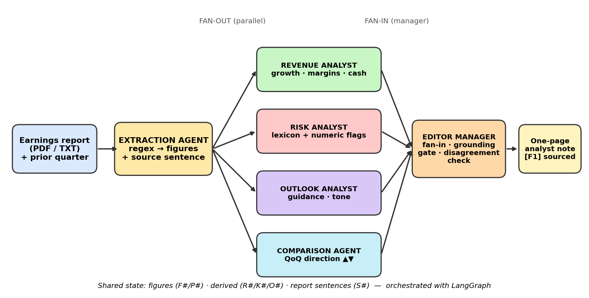

# 📊 Financial Earnings Report Analysis Desk
Multi-agent system (LangGraph + LangChain + Streamlit) that turns an earnings report into a **one-page analyst note**
(Revenue / Risk / Outlook / QoQ) where **every claim traces to an extracted figure**.



## Agents (each its own module in `agents/`)
Extraction · Revenue Analyst · Risk Analyst · Outlook Analyst · Comparison Agent (group-of-3 add-on) · Editor Manager
Architecture: **fan-out / fan-in with a manager** (see `docs/workflow.md`, `HOW_IT_WORKS.md`).

## Quick start
```bash
python -m venv .venv && source .venv/bin/activate      # Windows: .venv\Scripts\activate
pip install -r requirements.txt
streamlit run app.py                                   # interactive UI
python main.py                                         # CLI on the bundled sample -> analyst_note.md
pytest -q                                              # tests
```
Optional LLM-polished summary: `cp .env.example .env`, set `ANTHROPIC_API_KEY` (or `OPENAI_API_KEY`), `pip install langchain-anthropic`
(or `langchain-openai`), tick the checkbox in the sidebar / pass `--llm`. Works fully offline without it.

## Use your own report
Upload a PDF/TXT in the sidebar (add the previous quarter to enable the Comparison Agent). Press-release phrasing like
"Total revenue was $4.82 billion, up 12% year over year." is parsed best.

## Interactive features
Live workflow graph with timings · what-if figure editor · claim tracer · grounded Q&A · downloadable note.

## Layout
```
app.py  main.py  requirements.txt
agents/  extraction.py revenue_analyst.py risk_analyst.py outlook_analyst.py comparison_agent.py editor_manager.py
core/    models.py graph.py llm.py loader.py qa.py
sample_data/  acme_q3_2026.txt acme_q2_2026.txt
docs/    workflow.md workflow.png make_diagram.py
tests/   test_pipeline.py
```

## Requirement mapping
| Requirement | Where |
|---|---|
| Separate agent modules | `agents/*.py` |
| Fan-out / fan-in + manager | `core/graph.py`, `agents/editor_manager.py` |
| Structured extraction, claims traceable | `agents/extraction.py`, grounding gate in editor, `tests` |
| One-page note: revenue / risk / outlook + sourced figures | generated note + Sources table |
| Flag disagreement | `editor_manager._disagreements` |
| Group-of-3: previous-quarter direction | `agents/comparison_agent.py` |
